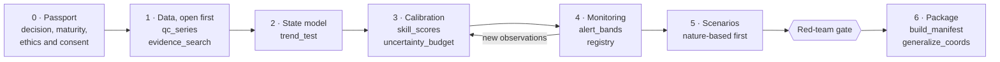

# Ecosystem Digital Twin — Agent Skill

[](https://github.com/Rigjite/Ecosystem-Digital-Twin/actions/workflows/tests.yml)

[](https://agentskills.io)

[](LICENSE)

English | [Русский](README.ru.md)

An [Agent Skill](https://agentskills.io) that lets an AI agent design, build,
audit, and report **digital twins of ecosystems** — ponds and lakes, river
reaches, farmland, air basins, and flora/fauna conservation sites — with the
rules of honest modeling enforced by code, not just written down.

A twin built with this skill mirrors a real place's current state, warns early
when the state degrades, and tests interventions in the model before anyone
touches the real system. It serves two uses, in this order: a **consulting
product** for a client (a farm, a water-body manager, a conservation project,
a municipality) and a **research instrument** for the operator's own science.

Current version: **2.0** (2026-10-21). License: CC BY 4.0.

## Why this skill

- **Claims are earned.** A twin is described by a five-level maturity ladder,
  from prototype to decision twin. A build that was never checked against
  observations ships labeled as a prototype, and a forecast must beat
  persistence and climatology on data it was not fitted to.
- **Forecasts are pre-registered.** An append-only, hash-chained registry
  records each forecast before its outcome is knowable and scores it exactly
  as issued — no back-dating, and a correction cannot erase a miss.
- **Every number traces to its evidence.** Deliverables ship as an
  RO-Crate 1.1 package; the build fails if a headline number in the report
  lacks its manifest ID.
- **Nature first, species safe.** Nature-based options are modeled before
  engineered ones, and sensitive species' coordinates are generalized per GBIF
  practice with a 0.1° floor before anything is shared.

## How a build runs



Each phase names the script that enforces its rule. The full workflow,
domain modules, and quality gates are in [`SKILL.md`](SKILL.md).

## Install

The skill folder must be named `ecosystem-digital-twin` — the `name` in
`SKILL.md` — whatever this repository is called.

- **Claude Code:** `git clone https://github.com/Rigjite/Ecosystem-Digital-Twin ~/.claude/skills/ecosystem-digital-twin`
- **Claude app (claude.ai, desktop, mobile):** download the zip from the
  latest release (the folder inside is already named correctly), or zip the
  folder yourself so that `ecosystem-digital-twin/SKILL.md` sits at the top of
  the archive, and upload it as a custom skill in the app's skills settings.
- **Other Agent Skills clients:** copy the folder into the client's skills
  directory.

Check an install from the skill folder: `python3 tests/check_package.py --strict`.

## Quick start

1. Read [`references/quick-start.md`](references/quick-start.md) — the
   ten-step path for a first or small build.
2. Fill the five forms in [`assets/templates.md`](assets/templates.md) as you
   go: object passport, risk register, trigger–action–response plan, option
   card, forecast registry entry.
3. Keep [`examples/lake-example.md`](examples/lake-example.md) beside you —
   one small lake carried through every form, end to end.

The scripts run anywhere Python 3.9+ does, with no installs. For example,
scoring a calibrated flow model on a declared hold-out period:

```bash
python3 scripts/skill_scores.py continuous flows.csv \
    --obs-col q_obs --sim-col q_sim --train-end 2019-12-31 --thresholds "NSE>=0.5"
```

It prints a JSON record and exits with 3 if the model misses a declared
threshold or fails to beat a naive baseline.

## What's inside

- **Full build cycle (Phases 0–6):** object passport and decision framing →
  open-first data inventory → state model → calibration and validation →
  monitoring, assimilation, and standing verification → improvement
  scenarios → deliverable as a provenance package.
- **A tiered indicator catalogue** (~200 indicators in 19 sections, from
  climate drivers and the hydrometric panel to sanitary microbiology, fauna by
  taxon, and pressure–response indicators), each with a tier and a named
  threshold anchor.
- **An evidence layer** routed across PubMed / PMC, Europe PMC, OpenAlex,
  Crossref, and regional-language sources: standards first, abstracts screen,
  full text decides, transferability is checked.
- **Analytics and anticipation:** historical data rescue with a bias and
  breaks register, pattern analysis, an event catalogue, event-based forecast
  validation, a risk register, and pre-agreed trigger–action–response plans.
- **Uncertainty and proof of effect:** computed uncertainty budgets, value of
  information, the forecast registry, and a counterfactual "no-action" twin
  that measures what an implemented measure actually changed.
- **Governed multi-agent work:** three orchestration tiers, written task
  contracts, and an independent red team at design, calibration, and delivery.

### Scripts

| Script | Phase | What it enforces |
|---|---|---|
| `scripts/qc_series.py` | 1 | Data quality gate: range, rate, stuck sensor, duplicates, gaps, neighbor station, change point; flags only, never edits |
| `scripts/evidence_search.py` | 1–5 | Literature retrieval across PubMed, Europe PMC, OpenAlex, Crossref; normalized JSON |
| `scripts/trend_test.py` | 1–2 | Mann–Kendall / Sen slope per segment between registered breaks; seasonal Kendall; autocorrelation handling |
| `scripts/skill_scores.py` | 3–4 | Declared hold-out, naive baselines, NSE/KGE/RMSE, POD/FAR/CSI, Brier with reliability |
| `scripts/uncertainty_budget.py` | 3 | Uncertainty budget by source from ensembles; an interval only from a joint ensemble |
| `scripts/alert_bands.py` | 4 | Amber/red bands with named anchors and sustained-breach windows |
| `scripts/registry.py` | 3–4 | Append-only, hash-chained forecast registry; scores forecasts exactly as issued |
| `scripts/generalize_coords.py` | all | Sensitive-species coordinate generalization (GBIF categories, 0.1° floor) with a pre-sharing check |
| `scripts/build_manifest.py` | 6 | RO-Crate 1.1 provenance package; every headline number traced and cited |

<details>
<summary>Package structure</summary>

| Path | Contents |
|---|---|
| `SKILL.md` | The skill itself: rules, phases, domain modules, script table, quality gates |
| `references/quick-start.md` | The one-page execution path and file map |
| `references/indicators.md` | The tiered indicator catalogue and threshold anchors |
| `references/data-sources.md` | Open-first data sources and interoperability standards (SensorThings, WaterML 2.0, Darwin Core, EML, STAC, CF, RO-Crate) |
| `references/evidence-sources.md` | Literature platform routing, query protocol, evidence hierarchy |
| `references/analytics-forecasting.md` | Historical data rescue, patterns, event catalogue, forecasting, risk register, preventive plans |
| `references/uncertainty-decision.md` | Quantitative uncertainty, value of information, forecast registry, counterfactual twin |
| `references/orchestration.md` | Multi-agent tiers, role contracts, independence rules, red-team gates |
| `references/scenarios.md` | Scenario library for improvement modeling |
| `references/world-practice.md` | The world practice the design builds on (Destination Earth, BioDT, EU Digital Twin of the Ocean, Delft-FEWS, Wageningen farm twins) |
| `assets/templates.md` | The five fillable forms |
| `examples/lake-example.md` | A worked miniature build (all values illustrative) |
| `scripts/` | The calculation toolkit above |
| `tests/test_scripts.py`, `tests/check_package.py` | Unit and end-to-end tests of the scripts; the package lint |
| `tests/TESTS.md` | Behavioral and automated tests (T1–T27), traceability table, run log |
| `CHANGELOG.md`, `CITATION.cff` | Version history; citation metadata |

</details>

## Status and evaluation

- **Automated:** 45 unit and end-to-end tests plus the package lint run on
  every push (see the tests badge). Run them locally with
  `python3 -m unittest discover -s tests` and `python3 tests/check_package.py`.
- **Evaluation history:** every round, its scores, and the defects found and
  fixed are logged in [`tests/TESTS.md`](tests/TESTS.md).
- **Not yet done:** the behavioral tests have not been run on a live water
  body or site. That pilot is the next milestone, and the run log says so.

## Roadmap

- Pilot build on a real water body with open data; run the behavioral tests
  live and publish the run log.
- Independent evaluation round of version 2.0.
- Data-access helpers: GBIF downloads with citable DOIs, Sentinel-2 via STAC.
- Export of the forecast registry in the Ecological Forecasting Initiative
  output and metadata standard.

Issues and suggestions are welcome.

## Citation

Use GitHub's **Cite this repository** button (from [`CITATION.cff`](CITATION.cff)), or:

Baldanova, R. (2026). *Ecosystem Digital Twin — Agent Skill* (v2.0).
https://github.com/Rigjite/Ecosystem-Digital-Twin

## License

CC BY 4.0 — see [`LICENSE`](LICENSE). You may reuse and adapt the skill with
attribution.
