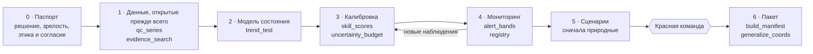

# Цифровой двойник экосистемы — навык для ИИ-агентов

[](https://github.com/Rigjite/Ecosystem-Digital-Twin/actions/workflows/tests.yml)

[](https://agentskills.io)

[](LICENSE)

[English](README.md) | Русский

Навык ([Agent Skill](https://agentskills.io)), с которым ИИ-агент проектирует,
строит, проверяет и описывает **цифровые двойники экосистем** — прудов и
озёр, участков рек, сельскохозяйственных земель, воздушных бассейнов и
территорий охраны флоры и фауны. Правила честного моделирования в нём не
только записаны, но и обеспечиваются кодом.

Двойник отражает текущее состояние реального места, заранее предупреждает об
ухудшении и проверяет вмешательства в модели — до того, как кто-либо затронет
реальную систему. Два назначения, в этом порядке: **консалтинговый продукт**
для заказчика (хозяйство, управляющий водоёмом, природоохранный проект,
муниципалитет) и **исследовательский инструмент** для собственной науки.

Текущая версия: **2.2** (2026-10-21). Лицензия: CC BY 4.0.
Текст навыка и справочники — на английском языке (`SKILL.md` и папка
`references/`); эта страница — русское описание пакета.

## Чем навык отличается

- **Заявления нужно заслужить.** Двойник описывается по пятиуровневой лестнице
  зрелости — от прототипа до двойника для решений. Сборка, не проверенная на
  наблюдениях, сдаётся с пометкой «прототип», а прогноз должен обыграть
  инерционный и климатический прогнозы на данных, на которых его не
  подгоняли.
- **Прогнозы регистрируются заранее.** Журнал только на дозапись, с
  хеш-цепочкой, фиксирует прогноз до того, как исход можно узнать, и
  оценивает его строго в зарегистрированном виде: задним числом ничего не
  внести, исправление не стирает промах.
- **Каждое число прослеживается до источника.** Результат сдаётся пакетом
  RO-Crate 1.1; сборка не проходит, если у ключевого числа в отчёте нет
  идентификатора из манифеста.
- **Сначала природные решения, виды в безопасности.** Природоподобные решения
  моделируются раньше инженерных, а координаты чувствительных видов
  огрубляются по практике GBIF (не точнее 0,1°) до любой передачи.

## Как идёт сборка



У каждой фазы — скрипт, который обеспечивает её правило. Полный порядок
работы, модули по типам объектов и ворота качества — в [`SKILL.md`](SKILL.md).

## Установка

Папка навыка должна называться `ecosystem-digital-twin` — как поле `name`
в `SKILL.md`, независимо от имени репозитория.

- **Claude Code:** `git clone https://github.com/Rigjite/Ecosystem-Digital-Twin ~/.claude/skills/ecosystem-digital-twin`
- **Приложение Claude (claude.ai, компьютер, телефон):** скачайте zip из
  последнего релиза (папка внутри уже названа правильно) или упакуйте папку
  сами так, чтобы `ecosystem-digital-twin/SKILL.md` лежал в корне архива, и
  загрузите его как собственный навык в настройках навыков приложения.
- **Другие клиенты Agent Skills:** скопируйте папку в их каталог навыков.

Проверка установки из папки навыка: `python3 tests/check_package.py --strict`.

## Быстрый старт

1. Прочитайте [`references/quick-start.md`](references/quick-start.md) — путь
   из десяти шагов для первой или малой сборки.
2. Заполняйте по ходу пять бланков из [`assets/templates.md`](assets/templates.md):
   паспорт объекта, реестр рисков, план «триггер — действие — реакция»,
   карточка варианта, запись журнала прогнозов.
3. Держите рядом [`examples/lake-example.md`](examples/lake-example.md) — одно
   маленькое озеро, проведённое через все бланки.

Скрипты работают везде, где есть Python 3.9+, без установки пакетов. Например,
оценка калиброванной модели стока на заранее объявленной отложенной выборке:

```bash
python3 scripts/skill_scores.py continuous flows.csv \
    --obs-col q_obs --sim-col q_sim --train-end 2019-12-31 --thresholds "NSE>=0.5"
```

Скрипт печатает запись JSON и завершается с кодом 3, если модель не достигла
объявленного порога или не обыграла наивный прогноз. Файлы с разделителем «;»
и десятичной запятой читаются без подготовки.

## Что внутри

- **Полный цикл (фазы 0–6):** паспорт объекта и постановка решения →
  инвентаризация данных с приоритетом открытых источников → модель
  состояния → калибровка и проверка → мониторинг, ассимиляция и постоянная
  верификация → сценарии улучшения → итоговый пакет с провенансом.
- **Многоуровневый каталог индикаторов** (около 200 индикаторов в 19
  разделах — от климатических драйверов и гидрометрии до санитарной
  микробиологии, фауны по таксонам и индикаторов давления и отклика); у
  каждого — уровень и именованный источник порога.
- **Слой доказательств:** PubMed / PMC, Europe PMC, OpenAlex, Crossref и
  региональные источники; сначала стандарты, реферат отбирает — полный текст
  решает, переносимость проверяется.
- **Аналитика и предвосхищение:** спасение исторических данных с реестром
  разрывов, анализ закономерностей, каталог событий, проверка прогнозов по
  событиям, реестр рисков и заранее согласованные превентивные планы.
- **Неопределённость и доказательство эффекта:** вычисляемые бюджеты
  неопределённости, ценность информации, журнал прогнозов и контрфактический
  двойник «без вмешательства», который измеряет, что реально изменила мера.
- **Управляемая мультиагентная работа:** три уровня оркестрации, письменные
  контракты задач и независимая красная команда. Если совет работает на
  моделях разных разработчиков через маршрутизатор, все скрипты запускает
  один исполнитель, а совет получает только краткие сводки: модели спорят о
  проверенных числах, но не вычисляют их и не участвуют в контуре тревог.

### Скрипты

| Скрипт | Фаза | Что обеспечивает |
|---|---|---|
| `scripts/qc_series.py` | 1 | Контроль качества: диапазон, скорость изменения, «залипание» датчика, дубли, пропуски, соседняя станция, точка разрыва; только флаги |
| `scripts/evidence_search.py` | 1–5 | Поиск литературы по PubMed, Europe PMC, OpenAlex, Crossref; нормализованный JSON |
| `scripts/trend_test.py` | 1–2 | Манн–Кендалл и наклон Сена по сегментам между разрывами; сезонный тест Кендалла; поправка Хамеда–Рао на автокорреляцию |
| `scripts/skill_scores.py` | 3–4 | Отложенная выборка, наивные эталоны с учётом горизонта прогноза, NSE/KGE/RMSE, POD/FAR/CSI, Брайер с таблицей надёжности |
| `scripts/uncertainty_budget.py` | 3 | Бюджет неопределённости по источникам из ансамблей; интервал только из совместного ансамбля |
| `scripts/alert_bands.py` | 4 | Жёлтая и красная зоны с источником порога и окном устойчивого превышения |
| `scripts/registry.py` | 3–4 | Журнал прогнозов только на дозапись, с хеш-цепочкой; оценка строго в зарегистрированном виде |
| `scripts/generalize_coords.py` | все | Огрубление координат чувствительных видов (категории GBIF, не точнее 0,1°) с проверкой перед передачей |
| `scripts/build_manifest.py` | 6 | Пакет провенанса RO-Crate 1.1; каждое ключевое число прослежено и процитировано |

<details>
<summary>Структура пакета</summary>

| Путь | Содержание |
|---|---|
| `SKILL.md` | Сам навык: правила, фазы, модули по типам объектов, таблица скриптов, ворота качества |
| `references/quick-start.md` | Путь исполнения на одной странице и карта файлов |
| `references/indicators.md` | Многоуровневый каталог индикаторов и источники порогов |
| `references/data-sources.md` | Открытые источники данных и стандарты интероперабельности |
| `references/evidence-sources.md` | Маршрутизация литературных платформ, протокол запросов, иерархия доказательств |
| `references/analytics-forecasting.md` | История, закономерности, каталог событий, прогнозирование, реестр рисков, превентивные планы |
| `references/uncertainty-decision.md` | Неопределённость, ценность информации, журнал прогнозов, контрфактический двойник |
| `references/orchestration.md` | Уровни мультиагентной работы, контракты, независимость, ворота красной команды |
| `references/scenarios.md` | Библиотека сценариев улучшения |
| `references/world-practice.md` | Мировая практика, на которой построен дизайн |
| `assets/templates.md` | Пять заполняемых бланков |
| `examples/lake-example.md` | Разобранная миниатюрная сборка (все значения учебные) |
| `examples/open-series-demo.md`, `examples/open_series_demo.py` | Испытание ядра на трёх открытых рядах (Нил, озеро Гурон, CO₂ Мауна-Лоа) — реальные воспроизводимые результаты |
| `scripts/` | Расчётные скрипты из таблицы выше |
| `tests/test_scripts.py`, `tests/check_package.py` | Юнит- и сквозные тесты скриптов; проверка пакета |
| `tests/TESTS.md` | Поведенческие и автоматические тесты (T1–T29), таблица прослеживаемости, журнал прогонов |
| `CHANGELOG.md`, `CITATION.cff` | История версий; данные для цитирования |

</details>

## Статус и проверка

- **Автоматически:** 48 юнит- и сквозных тестов и проверка пакета запускаются
  при каждой отправке изменений (значок tests). Локально:
  `python3 -m unittest discover -s tests` и `python3 tests/check_package.py`.
- **История оценок:** каждый раунд, его баллы, найденные и исправленные
  дефекты — в [`tests/TESTS.md`](tests/TESTS.md).
- **Ещё не сделано:** поведенческие тесты не запускались на живом водоёме
  или территории. Пилот — следующий этап, и журнал прямо это фиксирует.

## Планы

- Пилотная сборка на реальном водоёме с открытыми данными; живой прогон
  поведенческих тестов и публикация журнала.
- Независимая перекрёстная оценка версии 2.2 моделями разных разработчиков.
- Помощники для доступа к данным: выгрузки GBIF с цитируемым DOI, Sentinel-2
  через STAC.
- Экспорт журнала прогнозов в стандарт Ecological Forecasting Initiative.

Вопросы и предложения — через Issues.

## Цитирование

Кнопка **Cite this repository** на GitHub (из [`CITATION.cff`](CITATION.cff)) или:

Балданова Р. (2026). *Ecosystem Digital Twin — Agent Skill* (v2.2).
https://github.com/Rigjite/Ecosystem-Digital-Twin

## Лицензия

CC BY 4.0 — см. файл [`LICENSE`](LICENSE). Использование и адаптация разрешены
с указанием авторства.
